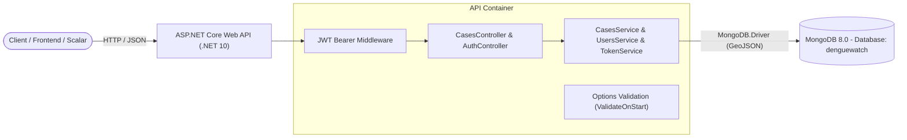

# DengueWatch 🦟 — .NET 10 & MongoDB API

[](https://dotnet.microsoft.com/)
[](https://www.mongodb.com/)
[](https://www.docker.com/)
[](https://scalar.com/)
[](https://xunit.net/)
[](#disclaimer--reference)

[English](README.md) | [Português (BR)](README.pt-BR.md)

**DengueWatch** is a production-grade, educational RESTful API built with **.NET 10** and **MongoDB 8**. The project tracks and manages geolocated Dengue fever case reports using native MongoDB GeoJSON coordinates, clean service layering, JWT Bearer authentication, and Docker Compose orchestration.

This repository was developed as an advanced evolution of the [Digital Innovation One (DIO)](https://web.dio.me) laboratory challenge *"Construindo um projeto de uma API .NET integrada ao MongoDB"*. It elevates the original reference prototype ([gabrielfaraday/dotnet-mongo](https://github.com/gabrielfaraday/dotnet-mongo)) into a modern, secured, fully containerized portfolio project.

---

## 📌 Architecture & Design Highlights



* **Modern .NET 10 & C# 14**: Clean code with top-level statements, primary constructors, records, and nullable reference types.
* **Geospatial GeoJSON Support**: Real coordinates stored as `GeoJsonPoint<GeoJson2DGeographicCoordinates>` (`[Longitude, Latitude]`), enabling spatial geospatial queries in MongoDB.
* **Layered Architecture**: Decoupled Controllers, DTOs, Service abstractions (`ICasesService`, `IUsersService`, `ITokenService`), and MongoDB documents.
* **Educational Authentication & Authorization**:
  * Token-based authentication using **JWT Bearer** with signature, issuer, audience, and lifetime validation.
  * Passwords securely hashed with ASP.NET Core Identity's `IPasswordHasher<T>`.
  * Mutation endpoints (`POST`, `PUT`, `DELETE`) protected by `[Authorize]`.
  * **Automatic Development Seeder**: Seeds a demo user with a unique index on `NormalizedEmail` on startup when enabled.
* **Fail-Fast Configuration**: Strongly typed Options pattern (`MongoSettings`, `JwtSettings`, `DemoUserSettings`) validated at application startup (`ValidateOnStart()`).
* **Next-Gen API Documentation**: OpenAPI 3.0 coupled with **Scalar API Reference** (`/scalar/v1`), configured with an OpenAPI transformer supporting interactive Bearer token testing.
* **Container-First**: Multi-stage, non-root (`$APP_UID`) `Dockerfile` and a `compose.yaml` orchestrating API and MongoDB with native healthchecks.

---

## 🚀 Tech Stack

| Technology | Purpose |
| :--- | :--- |
| **.NET 10 (C# 14)** | Core backend framework and runtime |
| **ASP.NET Core Controllers** | RESTful routing and model binding |
| **MongoDB.Driver (v3.12)** | Official MongoDB C# asynchronous driver |
| **MongoDB 8** | NoSQL document database with geospatial index capabilities |
| **Microsoft.AspNetCore.Authentication.JwtBearer** | JWT authentication and route authorization |
| **Scalar.AspNetCore** | Modern, interactive API documentation UI |
| **Docker & Docker Compose** | Multi-container environment and health monitoring |
| **xUnit v3 & Microsoft Testing Platform** | Unit testing suite with validation rules |

---

## 📡 API Endpoints

| HTTP Method | Route | Auth Required | Description |
| :--- | :--- | :---: | :--- |
| `POST` | `/api/Auth/login` | ❌ Public | Authenticates credentials and returns a JWT token |
| `GET` | `/api/Cases` | ❌ Public | Lists all reported Dengue cases |
| `GET` | `/api/Cases/{id}` | ❌ Public | Retrieves details for a specific case by `ObjectId` |
| `POST` | `/api/Cases` | 🔒 **Bearer JWT** | Registers a new Dengue case with coordinates |
| `PUT` | `/api/Cases/{id}` | 🔒 **Bearer JWT** | Updates an existing case report |
| `DELETE`| `/api/Cases/{id}` | 🔒 **Bearer JWT** | Removes a case report from the database |
| `GET` | `/health` | ❌ Public | Liveness and health check endpoint |
| `GET` | `/scalar/v1` | ❌ Public | Interactive Scalar API Reference (Development) |

### Sample Payload: Register Case (`POST /api/Cases`)
```json
{
  "dateOfBirth": "1994-08-15T00:00:00Z",
  "sex": "F",
  "latitude": -23.5630994,
  "longitude": -46.6565712
}
```

---

## 🛠️ Getting Started

### Prerequisites
* [Docker](https://docs.docker.com/get-docker/) & [Docker Compose](https://docs.docker.com/compose/) (recommended)
* Optional for bare-metal execution: [.NET 10 SDK](https://dotnet.microsoft.com/download)

---

### Method 1: Running with Docker Compose (Recommended)

1. **Clone the repository**:
   ```bash
   git clone https://github.com/ernanesa/denguewatch.git
   cd denguewatch
   ```

2. **Configure environment variables**:
   Copy `.env.example` to `.env`:
   ```bash
   cp .env.example .env
   ```
   > 💡 **Important:** Ensure `JWT_KEY` has at least 32 characters (256-bit). To enable the pre-configured demo user, set `DEMO_USER_SEED_ENABLED=true`:
   ```env
   DEMO_USER_SEED_ENABLED=true
   DEMO_USER_EMAIL=demo@denguewatch.local
   DEMO_USER_PASSWORD=DengueWatch@2026!Demo
   JWT_KEY=denguewatch-super-secret-jwt-signing-key-32chars
   ```

3. **Build and start containers**:
   ```bash
   docker compose up --build
   ```

4. **Explore the API**:
   * **Scalar API Documentation:** [http://localhost:5000](http://localhost:5000) (automatically redirects to `/scalar/v1`)
   * **Health Check:** [http://localhost:5000/health](http://localhost:5000/health)
   * **Direct MongoDB Port:** `localhost:27017`

---

### Method 2: Running Locally (.NET CLI)

1. Ensure a MongoDB instance is running locally on `localhost:27017` (e.g., via `docker compose up mongo -d`).
2. Set your environment variables or user secrets:
   ```bash
   export Jwt__Key="denguewatch-super-secret-jwt-signing-key-32chars"
   ```
3. Run the API:
   ```bash
   dotnet run --project api/api.csproj
   ```

---

## 🧪 Automated Tests

The testing suite validates request boundaries, geocoordinate limits (latitude `[-90, 90]`, longitude `[-180, 180]`), and model constraints using xUnit v3:

```bash
dotnet test tests/api.Tests/api.Tests.csproj
```

---

## 🗺️ Roadmap & Next Steps

This project follows an iterative evolution plan. Upcoming milestones include:

- [ ] **Expanded Test Coverage**:
  - Unit tests for `CasesService`, `TokenService`, and `UsersService`.
  - Integration tests using `Testcontainers.MongoDb` and `WebApplicationFactory<Program>` to test endpoints end-to-end against a real containerized MongoDB.
- [ ] **Interactive React Frontend**:
  - Modern Single Page Application (SPA) built with React 19, TypeScript, and Vite.
  - Interactive heatmaps and pin markers using Leaflet / Mapbox to plot Dengue clusters in real time.
  - Authentication dashboard for health agents to submit and manage reports.
- [ ] **AWS Cloud Deployment**:
  - Containerized production deployment on an **AWS EC2** instance using Docker & Docker Compose.
  - Reverse proxy with Nginx and automated SSL/TLS certificates via Let's Encrypt (Certbot).
  - Production secrets handled via AWS Systems Manager (SSM) Parameter Store.
- [ ] **CI/CD with GitHub Actions**:
  - Continuous Integration: Automated restore, linting, build, and test verification on every Pull Request.
  - Continuous Delivery: Automated Docker image build and zero-downtime deployment to AWS on merge to `main`.

---

## 📄 Disclaimer & Reference

* **Educational Project**: Uses synthetic and fictional data only. Do not use real patient or health data.
* **Challenge Origin**: Built for the [Digital Innovation One (DIO)](https://web.dio.me) Bootcamp challenge.
  * Course reference: [DIO lab — .NET API with MongoDB](https://www.dio.me/projects/construindo-um-projeto-de-uma-apinet-integrada-ao-mongodb)
  * Base repository reference: [gabrielfaraday/dotnet-mongo](https://github.com/gabrielfaraday/dotnet-mongo)

---

Developed with ☕ and clean code principles by **[Ernane](https://github.com/ernanesa)**.
