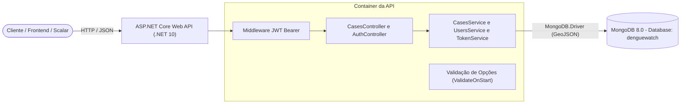

# DengueWatch 🦟 — API .NET 10 & MongoDB

[](https://dotnet.microsoft.com/)
[](https://www.mongodb.com/)
[](https://www.docker.com/)
[](https://scalar.com/)
[](https://xunit.net/)
[](#aviso-legal--referências)

[English](README.md) | [Português (BR)](README.pt-BR.md)

O **DengueWatch** é uma API RESTful educacional de nível profissional construída com **.NET 10** e **MongoDB 8**. O objetivo do projeto é registrar, consultar e gerenciar notificações de casos de dengue com coordenadas geolocalizadas em GeoJSON nativo do MongoDB, arquitetura em camadas de serviços, autenticação JWT Bearer e orquestração completa via Docker Compose.

Este repositório foi desenvolvido como uma evolução aprofundada do laboratório da [Digital Innovation One (DIO)](https://web.dio.me) *"Construindo um projeto de uma API .NET integrada ao MongoDB"*, elevando o protótipo de referência original ([gabrielfaraday/dotnet-mongo](https://github.com/gabrielfaraday/dotnet-mongo)) para um projeto robusto, seguro e conteinerizado para portfólio.

---

## 📌 Arquitetura & Destaques de Design



* **Modernidade com .NET 10 & C# 14**: Código enxuto com top-level statements, primary constructors, records e tipos anuláveis (*nullable reference types*).
* **Suporte Geoespacial com GeoJSON**: Coordenadas reais persistidas como `GeoJsonPoint<GeoJson2DGeographicCoordinates>` (`[Longitude, Latitude]`), permitindo consultas geoespaciais e criação de índices espaciais 2dsphere no MongoDB.
* **Separação de Responsabilidades**: Arquitetura desacoplada em Controllers, DTOs de entrada e saída, camada de Serviços (`ICasesService`, `IUsersService`, `ITokenService`) e Documentos BSON.
* **Segurança e Autenticação Educacional**:
  * Autenticação via **JWT Bearer** com validação rigorosa de assinatura, emissor (*issuer*), audiência (*audience*) e tempo de expiração.
  * Senhas armazenadas com hash criptográfico seguro usando o `IPasswordHasher<T>` do ASP.NET Core Identity.
  * Endpoints de mutação (`POST`, `PUT`, `DELETE`) protegidos com o atributo `[Authorize]`.
  * **Seeder Automático de Desenvolvimento**: Cria automaticamente no startup um usuário de demonstração com índice único em `NormalizedEmail` quando habilitado.
* **Configuração com Fail-Fast**: Uso do padrão *Options* fortemente tipado (`MongoSettings`, `JwtSettings`, `DemoUserSettings`) validado logo na inicialização da aplicação (`ValidateOnStart()`).
* **Documentação Interativa de Última Geração**: OpenAPI 3.0 integrado ao **Scalar API Reference** (`/scalar/v1`), com transformador OpenAPI configurado para suportar testes interativos autenticados com Bearer Token.
* **Foco em Contêineres**: `Dockerfile` multi-stage com usuário não-root (`$APP_UID`) e orquestração via `compose.yaml` com healthchecks nativos do MongoDB.

---

## 🚀 Tecnologias Utilizadas

| Tecnologia | Finalidade |
| :--- | :--- |
| **.NET 10 (C# 14)** | Framework e runtime principal da aplicação |
| **ASP.NET Core Controllers** | Roteamento RESTful e validação de modelos |
| **MongoDB.Driver (v3.12)** | Driver oficial assíncrono do MongoDB para C# |
| **MongoDB 8** | Banco de dados orientado a documentos NoSQL |
| **Microsoft.AspNetCore.Authentication.JwtBearer** | Autenticação por token JWT e controle de autorização |
| **Scalar.AspNetCore** | Interface visual moderna e interativa de documentação de API |
| **Docker & Docker Compose** | Ambientes conteinerizados e monitoramento de integridade |
| **xUnit v3 & Microsoft Testing Platform** | Suíte de testes automatizados e validações de regras |

---

## 📡 Endpoints da API

| Método | Rota | Autenticação | Descrição |
| :--- | :--- | :---: | :--- |
| `POST` | `/api/Auth/login` | ❌ Pública | Autentica as credenciais e retorna o token JWT |
| `GET` | `/api/Cases` | ❌ Pública | Lista todos os casos de dengue registrados |
| `GET` | `/api/Cases/{id}` | ❌ Pública | Busca detalhes de um caso específico pelo `ObjectId` |
| `POST` | `/api/Cases` | 🔒 **Bearer JWT** | Cadastra um novo caso com coordenadas geográficas |
| `PUT` | `/api/Cases/{id}` | 🔒 **Bearer JWT** | Atualiza os dados de um caso existente |
| `DELETE`| `/api/Cases/{id}` | 🔒 **Bearer JWT** | Remove o registro de um caso do banco de dados |
| `GET` | `/health` | ❌ Pública | Endpoint de verificação de saúde da API (*health check*) |
| `GET` | `/scalar/v1` | ❌ Pública | Interface interativa do Scalar (ambiente de Desenvolvimento) |

### Exemplo de Payload: Cadastro de Caso (`POST /api/Cases`)
```json
{
  "dateOfBirth": "1994-08-15T00:00:00Z",
  "sex": "F",
  "latitude": -23.5630994,
  "longitude": -46.6565712
}
```

---

## 🛠️ Como Executar o Projeto

### Pré-requisitos
* [Docker](https://docs.docker.com/get-docker/) e [Docker Compose](https://docs.docker.com/compose/) instalados (recomendado)
* Opcional (para rodar sem Docker): [.NET 10 SDK](https://dotnet.microsoft.com/download)

---

### Método 1: Executando com Docker Compose (Recomendado)

1. **Clone o repositório**:
   ```bash
   git clone https://github.com/ernanesa/denguewatch.git
   cd denguewatch
   ```

2. **Configure as variáveis de ambiente**:
   Copie o arquivo `.env.example` para `.env`:
   ```bash
   cp .env.example .env
   ```
   > 💡 **Atenção:** A chave `JWT_KEY` deve possuir no mínimo 32 caracteres (256 bits). Para ativar o usuário demo pré-configurado, mantenha `DEMO_USER_SEED_ENABLED=true`:
   ```env
   DEMO_USER_SEED_ENABLED=true
   DEMO_USER_EMAIL=demo@denguewatch.local
   DEMO_USER_PASSWORD=DengueWatch@2026!Demo
   JWT_KEY=denguewatch-super-secret-jwt-signing-key-32chars
   ```

3. **Suba os contêineres**:
   ```bash
   docker compose up --build
   ```

4. **Acesse os serviços**:
   * **Documentação Scalar:** [http://localhost:5000](http://localhost:5000) (redireciona automaticamente para `/scalar/v1`)
   * **Health Check:** [http://localhost:5000/health](http://localhost:5000/health)
   * **Porta do MongoDB:** `localhost:27017`

---

### Método 2: Executando Localmente (.NET CLI)

1. Inicie o MongoDB localmente na porta `27017` (ex: `docker compose up mongo -d`).
2. Defina as variáveis de ambiente necessárias:
   ```bash
   export Jwt__Key="denguewatch-super-secret-jwt-signing-key-32chars"
   ```
3. Execute a API:
   ```bash
   dotnet run --project api/api.csproj
   ```

---

## 🧪 Testes Automatizados

A suíte de testes valida limites de entrada, restrições geográficas (latitude `[-90, 90]` e longitude `[-180, 180]`) e integridade dos DTOs com xUnit v3:

```bash
dotnet test tests/api.Tests/api.Tests.csproj
```

---

## 🗺️ Próximos Passos & Roadmap

O DengueWatch foi desenhado para expansão contínua. As próximas fases do projeto incluem:

- [ ] **Aumentar a Cobertura de Testes**:
  - Testes unitários para `CasesService`, `TokenService` e `UsersService`.
  - Testes de integração utilizando `Testcontainers.MongoDb` e `WebApplicationFactory<Program>` para validar o fluxo de ponta a ponta com instâncias efêmeras do MongoDB em contêiner.
- [ ] **Desenvolver um Frontend em React**:
  - Criação de uma Single Page Application (SPA) com React 19, TypeScript e Vite.
  - Mapas de calor (*heatmaps*) e marcadores de geolocalização com Leaflet ou Mapbox para exibição visual dos focos e casos em tempo real.
  - Painel administrativo autenticado para agentes de saúde registrarem ocorrências em campo.
- [ ] **Hospedagem na AWS (EC2 + Docker)**:
  - Provisionamento e deploy da stack completa na nuvem via **AWS EC2** com Docker Compose.
  - Configuração de proxy reverso com Nginx e certificados SSL/TLS automáticos com Let's Encrypt (Certbot).
  - Gestão de credenciais e segredos produtivos via AWS Systems Manager (SSM) Parameter Store.
- [ ] **Integração e Entrega Contínua (CI/CD) com GitHub Actions**:
  - Pipeline de CI: linting, compilação e execução de testes automatizados a cada Pull Request ou push.
  - Pipeline de CD: build automatizado da imagem Docker e deploy contínuo (*zero-downtime*) na instância AWS após merge na branch `main`.

---

## 📄 Aviso Legal & Referências

* **Projeto Educacional**: Utiliza dados estritamente sintéticos e fictícios. Não utilize dados reais de pacientes ou saúde pública.
* **Origem do Desafio**: Desenvolvido para o desafio prático de laboratório da [Digital Innovation One (DIO)](https://web.dio.me).
  * Referência do curso: [Laboratório DIO — API .NET com MongoDB](https://www.dio.me/projects/construindo-um-projeto-de-uma-apinet-integrada-ao-mongodb)
  * Repositório de referência do expert: [gabrielfaraday/dotnet-mongo](https://github.com/gabrielfaraday/dotnet-mongo)

---

Desenvolvido com ☕ e foco em código limpo por **[Ernane](https://github.com/ernanesa)**.
